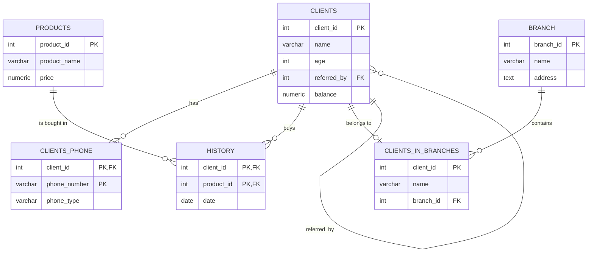

# Database Fall 2026: PostgreSQL Labs

Lab work for the Database course. Each lab follows the course instructions step by step, and every action and its result is saved as a screenshot in the lab's folder.

**Author:** [jamusssik](https://github.com/jamusssik)
**Tools:** PostgreSQL 18 (Homebrew, macOS) · `psql` · DataGrip · pgAdmin (ER diagram in Lab 10)

---

## Labs

| Lab | Topic | What was done |
|---|---|---|
| [3](lab_3/) | Basic psql Commands | Listing databases with `\l`, connecting with `\c`, running `CREATE TABLE` → `INSERT` → `SELECT` → `DROP TABLE` from the terminal, exiting with `\q` |
| [4](lab_4/) | First SQL Query | Creating and filling a `students_one_1` table, `SELECT *`, `SELECT` with `WHERE`; `ORDER BY` and `LIMIT` are in [`week4.sql`](lab_4/week4.sql) |
| [5](lab_5/) | Databases | `CREATE DATABASE` and `DROP DATABASE` |
| [6](lab_6/) | Tables, Data Types and Constraints | `CREATE TABLE` with `SERIAL`, `VARCHAR`, `NOT NULL`, `UNIQUE`; `ALTER TABLE` (add column, drop column, change type, rename column, rename table); `DROP TABLE`; temporary table |
| [7](lab_7/) | Primary Keys | Three ways to define a primary key (column-level, table-level, named constraint), composite primary key, `SERIAL`, `BIGSERIAL`, `IDENTITY` columns, duplicate-key (`UNIQUE`) and `NOT NULL` violations. Code: [`lab_7.sql`](lab_7/lab_7.sql) |
| [8](lab_8/) | Foreign Keys and Relationships | Four ways to create a foreign key (inline, table-level, `ALTER TABLE`, named), `ON DELETE CASCADE` / `SET NULL` / `SET DEFAULT` / `RESTRICT`, `ON UPDATE CASCADE`, combined cascade options, one-to-one (own example), one-to-many and many-to-many relationships |
| [9](lab_9/) | Database Design Basics | Normalization (1NF, 2NF, 3NF), applied to the shop database used in the later labs |
| [10](lab_10/) | Viewing Database and Table Structure | `\dt`, `\d table_name`, ER diagram of the database |
| [11](lab_11/) | Basic Data Operations | `INSERT`, `UPDATE`, `DELETE`, bulk `UPDATE` |
| [12](lab_12/) | Querying Data | `SELECT`, comparison operators, `LIKE`, regular expressions (case-sensitive and case-insensitive matching, names starting with A or B), `IN`, `EXISTS`, `CASE`, CTEs |
| [13](lab_13/) | Aggregate Functions | `COUNT`, `SUM`, `AVG`, `MIN`/`MAX`, `STRING_AGG`, `ARRAY_AGG`, `GROUP BY` (basic, several columns, `CASE` expression), `HAVING`, window functions vs aggregates, NULL handling, several aggregates at once, conditional aggregation, percentages |
| [14](lab_14/) | Joining Tables | `INNER`, `LEFT`, `RIGHT`, `FULL` and `CROSS JOIN`, joining multiple tables, self join, joins with conditions, one-to-one / one-to-many / many-to-many joins, indexes on join columns, choosing the right join type, table aliases |
| [15](lab_15/) | Advanced Querying | Scalar, row and table subqueries, CTE (`WITH`), recursive query, pivot and unpivot, `FILTER` clause, `EXPLAIN` / `EXPLAIN ANALYZE` |
| [16](lab_16/) | Transactions and ACID | `BEGIN` / `COMMIT`, `ROLLBACK`, atomicity (a failed `CHECK` constraint undoing the whole transaction) |
| [17](lab_17/) | Data Import/Export and Backup | `COPY` import and export (CSV options, custom delimiter and NULL, `FORCE_QUOTE`, `ON_ERROR`), WAL settings and restore points, logical replication (publication), ETL with `ON CONFLICT`, table partitioning; in the terminal: `pg_dump`, `pg_restore`, `pg_dumpall`, an automated backup script and `pg_basebackup`. Code: [`lab_17.sql`](lab_17/lab_17.sql) |

---

## Shop database (Labs 9 and 12–17)

From Lab 9 on, the labs use one database that models a small electronics shop.



| Table | Purpose |
|---|---|
| `clients` | Shop clients. `referred_by` was added in Lab 15 for the recursive query, and `balance` in Lab 16 for transactions |
| `clients_phone` | Clients' phone numbers (mobile / home / work); one-to-many with `clients` |
| `products` | Products and prices |
| `history` | Purchases: the junction table of the many-to-many relationship between `clients` and `products` |
| `branch` | Shop branches |
| `clients_in_branches` | The branch each client belongs to |

---

## Repository structure

```
.
├── README.md
├── lab_3/   …   lab_16/     screenshots of each step (some labs also have a .sql file)
└── lab_17/                  lab_17.sql
```

Screenshots are named after the concept they show, for example `left join.png` or `ON DELETE CASCADE.png`. A file named `result of …` shows the output of the query in the screenshot with the matching name.
